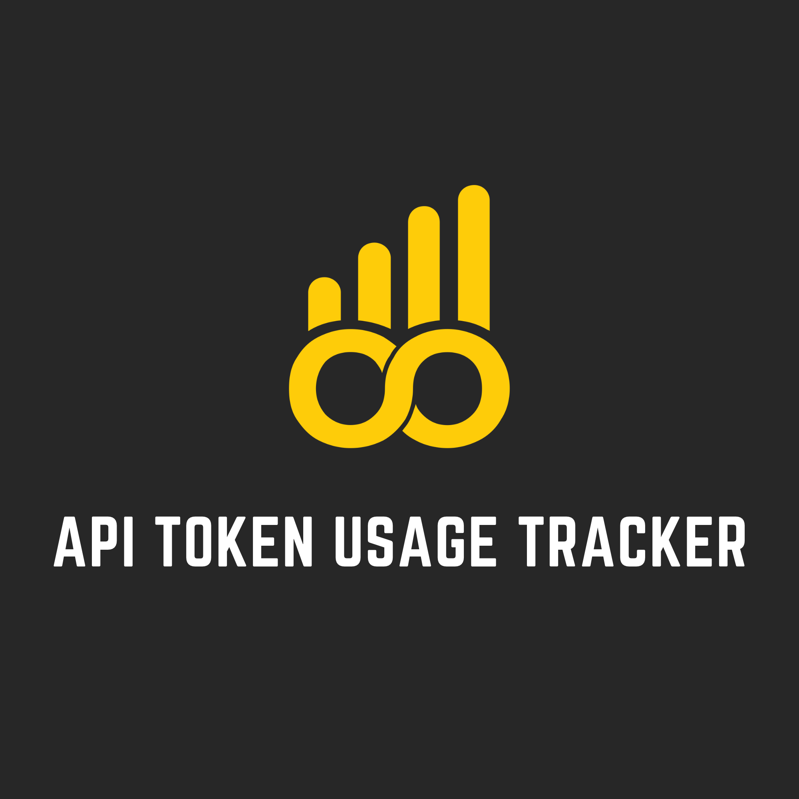

<div align="center">

  

  # API Token Usage Tracker

  **An open-source full-stack application for monitoring API token consumption, analyzing usage patterns, and estimating API costs.**

  Developed and maintained by the **SFU Open Source Development Club (OS DEV)**.

</div>

## About the Project

API Token Usage Tracker is a full-stack web application designed to help developers monitor, analyze, and manage API token consumption and associated costs.

As developers increasingly integrate token-based APIs into their applications, understanding usage patterns and estimating operational costs becomes essential.

This project aims to provide a centralized dashboard where developers can record API usage, visualize consumption statistics, analyze estimated costs, and monitor monthly spending.

The project is part of the **SFU OS DEV Fall 2026 Open Source Project Initiative**, providing students with hands-on experience in full-stack development, REST API design, database management, data visualization, and collaborative software engineering.

**Project Status:** Early Development — Planning & Initial Setup

## Key Features

The following features are planned for development:

| Feature | Description | Status |
|---|---|---|
| Token Usage Tracking | Record and monitor input, output, and total token consumption | Planned |
| API Cost Analysis | Calculate estimated API costs based on token usage and model pricing | Planned |
| Monthly Bill Estimation | Estimate monthly API expenses from recorded consumption | Planned |
| Interactive Dashboard | Visualize token usage, estimated costs, and trends through charts | Planned |
| Usage History | Explore historical usage records by date, model, or API provider | Planned |
| Usage Statistics | Analyze usage patterns and identify high-consumption periods | Planned |

Additional features may be proposed and implemented by project contributors.

## Tech Stack

| Category | Technologies |
|---|---|
| Frontend | React, TypeScript, Vite |
| Backend | Python, FastAPI |
| Database | PostgreSQL |
| ORM | SQLAlchemy |
| Database Management | Adminer |
| Data Visualization | Recharts (Planned) |
| Containerization | Docker, Docker Compose |
| CI/CD | GitHub Actions |
| Version Control | Git, GitHub |

The technology stack may evolve as the project develops.

## Project Architecture

The application follows a full-stack architecture separating the user interface, API services, and database.

```text
               React + TypeScript
                (Web Dashboard)
                       |
                       | HTTP / REST API
                       v
                 Python + FastAPI
                    (Backend)
                       |
             +---------+---------+
             |                   |
             v                   v
        Usage Tracking      Cost Calculation
             |                   |
             +---------+---------+
                       |
                       | SQLAlchemy
                       v
                   PostgreSQL
                    (Database)
                       ^
                       |
                    Adminer
             (Local DB Management)
```

### Component Responsibilities

**Frontend**
- Display token consumption and estimated costs.
- Render interactive charts and usage statistics.
- Provide filters for dates, models, and API providers.
- Communicate with backend REST API endpoints.

**Backend**
- Receive and validate API usage records.
- Process token consumption data.
- Calculate estimated costs using configurable pricing.
- Aggregate usage statistics.
- Provide REST API endpoints for the dashboard.

**Database**
- Store API usage records.
- Maintain model and provider information.
- Store pricing configurations.
- Support historical usage queries and aggregations.

**Adminer**
- Inspect PostgreSQL tables during development.
- Execute SQL queries.
- Verify usage records and database operations.

### Planned Data Flow

1. An application or test client submits a token usage record.
2. FastAPI validates the incoming data.
3. The backend processes the usage record.
4. The record is stored in PostgreSQL.
5. The cost calculation service estimates the corresponding API cost.
6. The frontend retrieves usage statistics through REST API endpoints.
7. The dashboard displays token consumption, estimated costs, and usage trends.

The first development phase will use mock data and sample API requests. Integration with external API providers may be introduced later.

## Repository Structure

The planned repository structure is:

```text
api-token-usage-tracker/
├── frontend/
│   ├── src/
│   │   ├── components/
│   │   ├── pages/
│   │   ├── services/
│   │   └── App.tsx
│   └── package.json
│
├── backend/
│   ├── app/
│   │   ├── api/
│   │   ├── models/
│   │   ├── schemas/
│   │   ├── services/
│   │   │   ├── usage_service.py
│   │   │   └── cost_service.py
│   │   └── main.py
│   ├── tests/
│   └── requirements.txt
│
├── docs/
│   ├── architecture.md
│   └── setup.md
│
├── .github/
│   ├── workflows/
│   ├── ISSUE_TEMPLATE/
│   └── pull_request_template.md
│
├── .env.example
├── .gitignore
├── compose.yaml
├── CONTRIBUTING.md
├── LICENSE
└── README.md
```

This structure represents the planned architecture and will be updated as the initial codebase is implemented.

## Getting Started

We welcome contributors of all experience levels.

### Prerequisites

The planned development environment uses:

- Git
- Node.js and npm
- Python 3
- Docker Desktop or Docker Engine with Docker Compose
- Visual Studio Code or another preferred IDE

### 1. Fork the Repository

Visit the official SFU OS DEV repository:

https://github.com/sfuosdev/api-token-usage-tracker

Click **Fork** to create a copy under your personal GitHub account.

### 2. Clone Your Fork

```bash
git clone https://github.com/YOUR_USERNAME/api-token-usage-tracker.git
cd api-token-usage-tracker
```

Replace `YOUR_USERNAME` with your GitHub username.

### 3. Configure the Upstream Repository

```bash
git remote add upstream https://github.com/sfuosdev/api-token-usage-tracker.git
```

Verify the configuration:

```bash
git remote -v
```

### 4. Set Up the Development Environment

The frontend, backend, PostgreSQL database, and Adminer services will be configured during the initial development phase.

Once the starter codebase is available, detailed installation and startup instructions will be provided in:

`docs/setup.md`

The planned development environment will support Docker Compose for running application services locally.

**Note:** The application is currently in early development. Executable installation commands will be documented and verified once the initial codebase is ready.

## API Design

The backend will expose REST API endpoints for recording, retrieving, and analyzing token usage.

### Planned API Endpoints

| Method | Endpoint | Description |
|---|---|---|
| GET | `/health` | Check backend service availability |
| POST | `/api/v1/usage` | Submit an API token usage record |
| GET | `/api/v1/usage` | Retrieve usage history |
| GET | `/api/v1/usage/summary` | Retrieve aggregated usage statistics |
| GET | `/api/v1/costs/summary` | Retrieve estimated API costs |
| GET | `/api/v1/costs/monthly` | Retrieve monthly cost estimates |
| GET | `/api/v1/models` | Retrieve supported API models and pricing information |

These endpoints are proposed interfaces and may change as the backend architecture develops.

### Example Usage Record

A future API usage record may follow this structure:

```json
{
  "provider": "example-provider",
  "model": "example-model",
  "input_tokens": 1200,
  "output_tokens": 350,
  "timestamp": "2026-10-14T12:00:00Z"
}
```

The backend will validate the record and use the corresponding model pricing configuration to calculate estimated usage costs.

Actual request and response schemas will be finalized during implementation.

## Cost Calculation

The application will estimate costs using token counts and configurable API pricing.

For a model with separate input and output token prices:

**Estimated Cost = (Input Tokens × Input Token Rate) + (Output Tokens × Output Token Rate)**

Pricing rates must be expressed in cost per token or converted to that unit before calculation.

For example, if prices are quoted per one million tokens:

```text
Estimated Cost =
    (Input Tokens / 1,000,000 × Input Price per 1M)
  + (Output Tokens / 1,000,000 × Output Price per 1M)
```

The application will eventually support:

- Model-specific pricing
- Separate input and output token rates
- Historical usage aggregation
- Monthly estimated spending
- Usage trends by provider and model

**Important:** Calculated costs are estimates, not official invoices. Actual provider billing may vary because of caching, pricing changes, discounts, additional charges, or other billing rules.

## Development Roadmap

### Phase 1 — Project Initialization
- [ ] Initialize React + TypeScript frontend
- [ ] Initialize FastAPI backend
- [ ] Configure PostgreSQL database
- [ ] Integrate Adminer for local database inspection
- [ ] Set up Docker Compose
- [ ] Configure GitHub Actions CI
- [ ] Establish initial automated tests

### Phase 2 — Backend & Database Development
- [ ] Design token usage database schema
- [ ] Create SQLAlchemy models
- [ ] Implement usage record validation
- [ ] Develop REST API endpoints
- [ ] Implement token usage logging
- [ ] Create usage history retrieval endpoints

### Phase 3 — Cost Analysis
- [ ] Design model pricing configuration
- [ ] Implement cost calculation service
- [ ] Calculate estimated usage costs
- [ ] Develop monthly bill estimation
- [ ] Implement usage aggregation
- [ ] Add automated tests for cost calculations

### Phase 4 — Dashboard Development
- [ ] Design dashboard UI
- [ ] Create token consumption charts
- [ ] Visualize estimated monthly costs
- [ ] Implement usage filtering
- [ ] Connect frontend to backend APIs
- [ ] Display historical usage trends

### Phase 5 — Integration & Deployment
- [ ] Complete frontend and backend integration
- [ ] Expand automated testing
- [ ] Validate database operations
- [ ] Improve error handling
- [ ] Configure CI/CD workflows
- [ ] Prepare deployment configuration
- [ ] Release an initial working version

Project milestones and implementation priorities will be determined collaboratively by the project team.

## Contributing

Contributions are welcome from SFU students and the broader open-source community.

Whether you are interested in frontend development, backend development, database engineering, API integration, UI/UX design, testing, or documentation, there are opportunities to contribute.

### Contribution Workflow

1. **Find an Issue** — Explore available tasks in GitHub Issues.
2. **Fork the Repository** — Create a personal copy of the project.
3. **Clone Your Fork** — Set up the project on your local machine.
4. **Create a Feature Branch** — Develop your changes independently.
5. **Develop & Test** — Implement and verify your changes.
6. **Push Changes** — Push commits to your personal fork.
7. **Submit a Pull Request** — Request to merge your changes into the official repository.
8. **Review & Merge** — Maintainers review and merge approved contributions.

### Branch Naming Conventions

Use descriptive branch names:

```text
feature/usage-tracking
feature/cost-calculator
feature/dashboard-charts

fix/token-calculation
fix/database-connection

docs/update-readme
test/usage-endpoints
```

### Example Git Workflow

Update your local `main` branch:

```bash
git checkout main
git fetch upstream
git merge upstream/main
```

Create a new feature branch:

```bash
git checkout -b feature/usage-dashboard
```

Stage and commit your changes:

```bash
git add .
git commit -m "feat: add token usage dashboard"
```

Push your branch:

```bash
git push -u origin feature/usage-dashboard
```

Then open a Pull Request from your feature branch to the official OS DEV repository.

Before submitting a PR, ensure your changes are tested and documented.

For detailed contribution guidelines, refer to [CONTRIBUTING.md](CONTRIBUTING.md) once available.

## Project Management

The project will use GitHub Issues, Pull Requests, and GitHub Projects to manage development.

### GitHub Issues

Issues are used to organize:

- Feature development
- Bugs and fixes
- API design
- Database improvements
- UI/UX enhancements
- Testing
- Documentation
- Research tasks

### GitHub Projects

Tasks may be organized into the following stages:

| Stage | Description |
|---|---|
| Backlog | Proposed tasks awaiting review |
| To Do | Approved tasks ready for development |
| In Progress | Tasks currently being developed |
| In Review | Changes awaiting review |
| Done | Completed and merged tasks |

### Pull Requests

Each Pull Request should include:

- A clear description of changes
- A related GitHub Issue, when applicable
- Testing performed
- Screenshots for visual changes, when applicable

Project maintainers will review contributions before merging them into the main branch.

## Security & Data Handling

API usage monitoring may involve sensitive development information.

Contributors must follow these principles:

- Never commit API keys, access tokens, passwords, or private credentials.
- Store local configuration in environment variables.
- Keep `.env` files out of version control.
- Use dummy or synthetic usage data during early development.
- Avoid collecting unnecessary request content or personal information.
- Do not publicly expose Adminer or development databases.
- Validate incoming API usage records.
- Use appropriate authentication and authorization before accepting real multi-user data.

Real API provider integrations should be reviewed for security and provider-specific data handling requirements before deployment.

## Team & Maintainers

**Organization:** SFU Open Source Development Club (OS DEV)

**Academic Term:** Fall 2026

**Project Lead:** To be assigned

**Project Contributors:** To be announced

The project is developed collaboratively by students interested in software engineering and open-source development.

## Learning Objectives

Through this project, contributors will gain practical experience in:

- Full-stack web application development
- REST API design and integration
- Token-based API usage monitoring
- Data processing and aggregation
- Relational database design and SQL
- Cost estimation algorithms
- Interactive dashboard development
- Docker-based development environments
- Git and GitHub collaboration
- Pull Requests and code reviews
- Automated testing and CI/CD
- Technical documentation and teamwork

Our goal is to provide a collaborative environment where students can build practical software while gaining experience with real-world engineering workflows.

## License

This project is intended to be released under the MIT License, subject to confirmation of contributor rights and third-party licensing requirements.

Once finalized, the full license terms will be available in the repository's `LICENSE` file.

## Connect With SFU OS DEV

- **GitHub Organization:** https://github.com/sfuosdev
- **Instagram:** https://www.instagram.com/sfu_osdev/
- **SFSS Club Page:** https://go.sfss.ca/clubs/867/info

---

**Built by students, for developers.**

*SFU Open Source Development Club — Design. Develop. Deploy.*
